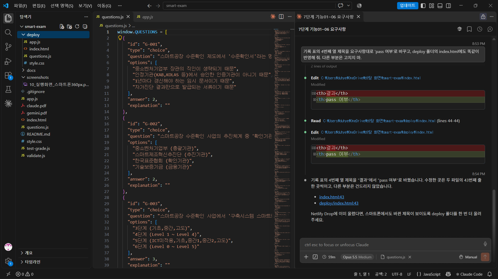

# 스마트공장 수준확인 심사원 모의고사 웹앱 (11주차 Claude 코딩 과제)

스마트공장 수준확인 심사원 온라인 시험(25문제, 18문제 이상 pass)을 대비하기 위해
**VS Code + Claude Code**로 단계별 지시(한글 프롬프트)를 주어 만든 모의고사 웹앱입니다.
PC와 스마트폰 브라우저에서 모두 사용할 수 있습니다.

- 🔗 바로 풀어보기(GitHub Pages): https://sangdookim.github.io/smart-exam/
- 📄 Claude Code 단계별 지시문: [docs/claude-code-steps.md](docs/claude-code-steps.md)

## 구현 기능 (필수 6가지)

| 기능 | 내용 | 구현 위치 |
|---|---|---|
| 기능01 | 220문제(Gemini 100 + Claude 120)에서 중복 없이 25문제 무작위 출제 | `app.js` `pickRandom()` |
| 기능02 | 한 화면에 한 문제, 객관식은 라디오 버튼 / 단답형은 텍스트박스 | `app.js` `renderQuestion()` |
| 기능03 | 위 2/3 문제 영역, 아래 1/3 답 확인 영역, 오른쪽 위 [답 확인] [Next] 버튼 | `index.html`, `style.css` |
| 기능04 | 답 없이 [Next] → "답을 하지 않으면 모의고사가 진행되지 않아요" + [확인] | `app.js` `onNext()` |
| 기능05 | 25번째 문제 후 채점, "25문제 중 OO문제 정답" + 18개 이상 pass / 미만 fail | `app.js` `grade()` |
| 기능06 | [모의종료] → 날짜·회차·맞춘 개수·pass 여부 기록 리스트(localStorage) | `app.js` `onEnd()`, `renderHistory()` |

## 파일 구성

```
smart-exam/
├─ index.html      화면 구조(시작 / 문제 / 기록 / 알림창)
├─ style.css       흰 배경 기본 스타일, 360px 스마트폰 대응, 100dvh
├─ app.js          출제·채점·기록 로직
├─ questions.js    220문제 데이터 (window.QUESTIONS)
├─ validate.js     문제 데이터 검증 스크립트 (node validate.js)
├─ test-grade.js   채점 검증 17개=fail / 18개=pass (node test-grade.js)
├─ deploy/         배포용 4개 파일 (Netlify Drop / GitHub Pages)
├─ docs/           Claude Code 단계별 지시문
└─ screenshots/    VS Code 작업 화면 캡쳐
```

## Claude 코딩 진행 단계

1. 전체 작업 이해시키기 (파일 4개 역할 설명)
2. PDF 2개 → `questions.js` 변환 (G-001~G-100, C-001~C-100, S-001~S-020)
3. 데이터 검증 (문제 수·id·보기 4개·정답 범위·PDF 정답표 재대조·잔여 문구)
4. 문제 화면과 기능 1~3
5. 미응답 알림과 채점 (기능 4~5) + 17/18개 경계값 검증
6. 모의종료와 기록 리스트 (기능 6)
7. 최종 점검 → Claude Code가 찾은 차이(기록 표 열 제목 "결과" → "pass 여부") 수정 → deploy 폴더 배포

## VS Code 작업 화면 캡쳐

### 1) 프로젝트 구조와 문제 데이터(questions.js)


### 2) 3단계 데이터 검증 — `node validate.js`
220문제 / 객관식 200 / 단답형 20, id·보기·정답·잔여 문구 검사 모두 통과


### 3) 5단계 채점 검증 — `node test-grade.js`
17개 정답 → fail, 18개 정답 → pass, 단답형 공백·대소문자 무시 확인


### 4) 7단계 Claude Code 최종 점검 — 기능01~06 요구사항 대조표


### 5) Claude Code가 제안한 수정(diff)을 확인하고 승인


### 6) 수정 완료 (index.html, deploy/index.html)


### 7) 실행 화면 (스마트폰 폭 360px)
시작 → 답 확인 → 미응답 알림 → 채점 결과 → 기록 리스트


## 사용 방법

- PC: `index.html` 더블클릭
- 스마트폰: 위 GitHub Pages 주소 접속 → 브라우저 메뉴에서 "홈 화면에 추가"
- 기록은 기기별 localStorage에 저장되므로 PC와 스마트폰 기록은 합쳐지지 않습니다.

## 교재로 확인할 문제

두 문제집의 내용이 서로 달라 교재 기준 확인이 필요한 문항입니다.

| 내용 | Gemini 문제집 | Claude 문제집 |
|---|---|---|
| 기업제조혁신역량 수준 | G-004: Level 0~5, 6단계 | C-066, S-004: Level 1~5, 5단계 (C-090은 Level 0 인정) |
| 구축시스템 스마트화 수준 | G-003: ICT 미적용 포함 5단계 | S-003: 4단계 |

> 문제 원본 PDF는 저장소에 포함하지 않았습니다(.gitignore).
